# cozisboy

A custom Linux system for the **Anbernic RG35XX SP** (Allwinner H700): mainline
Linux, a Buildroot root filesystem, and its own launcher. It boots in about 3 s
to a pixel-art home screen and plays GBA games (mGBA), with Wi-Fi, Bluetooth,
sleep, rumble and a web app to manage games and saves from a PC or phone.

<p align="center">
  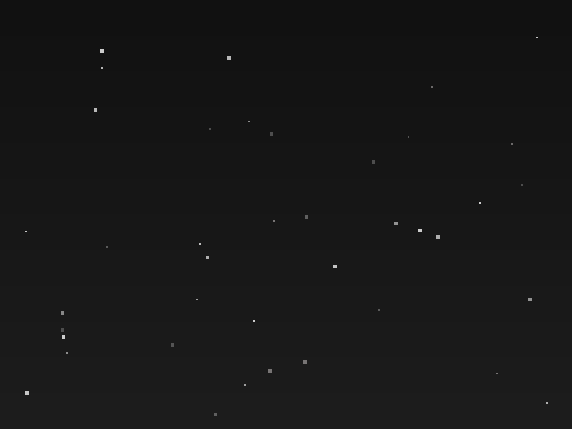
  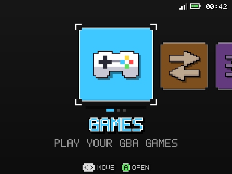
</p>

Games are not included: bring your own (or free homebrew, e.g. from
[Homebrew Hub](https://hh.gbdev.io), which the web app can browse and install).

## Screens

<p align="center">
  
  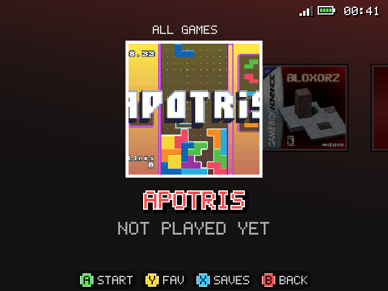
  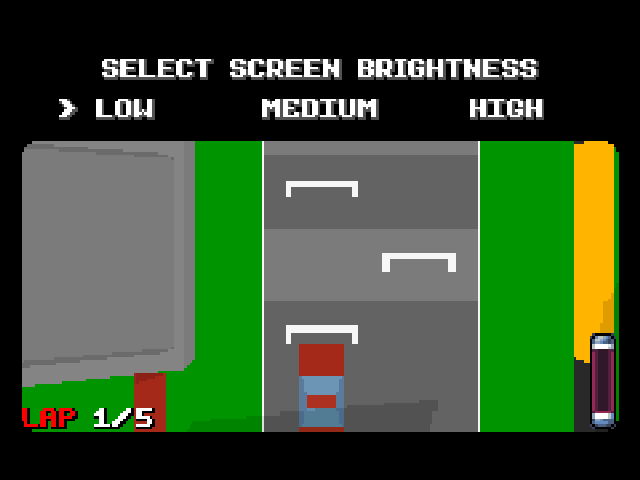
</p>
<p align="center">
  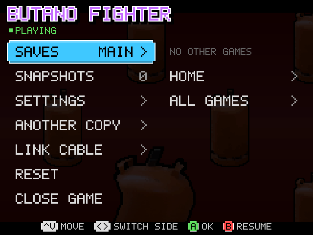
  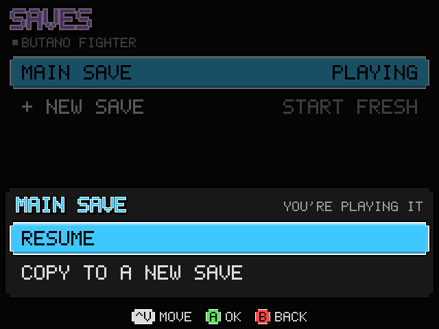
  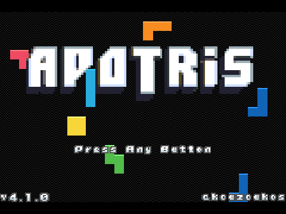
</p>
<p align="center">
  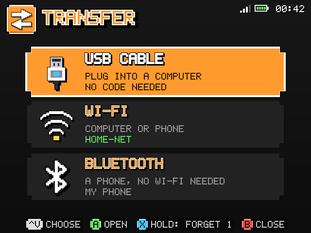
  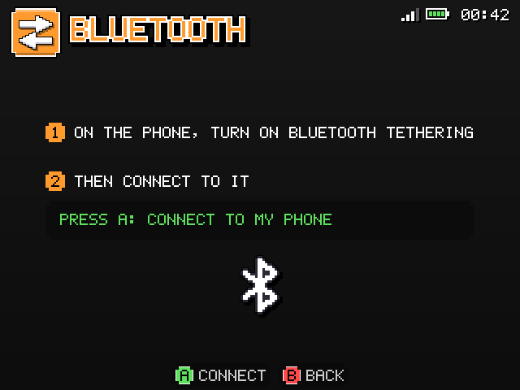
  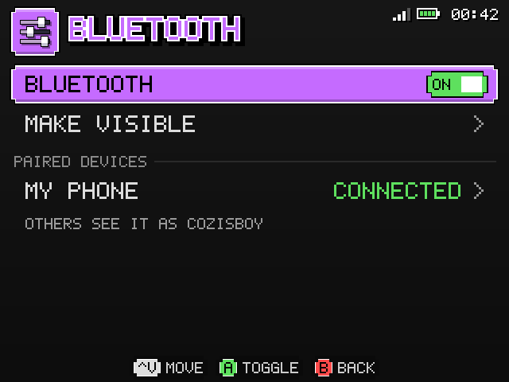
</p>
<p align="center">
  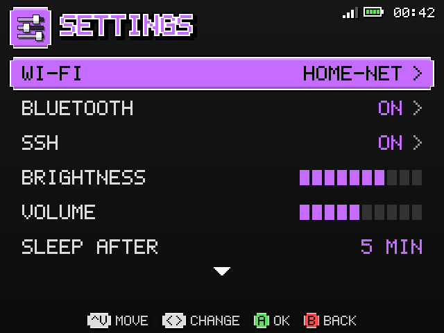
  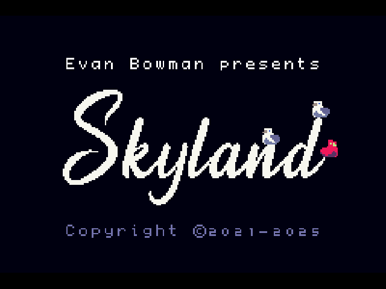
</p>

Shown with free homebrew from Homebrew Hub (Skyland, Apotris, Varooom 3D,
Butano Fighter and others), captured with the launcher's headless screenshot
driver.

## What's here

| Path | What |
|---|---|
| `apps/ui` | The launcher (C, no toolkit): home, games, saves, snapshots, settings, TRANSFER. Runs on the device framebuffer, or on a PC with SDL2 for development (`make -C apps/ui run`). |
| `apps/web` | The web app the launcher starts from TRANSFER: a small C HTTP server (`web.c`) and a single-page UI (`index.html`). |
| `apps/common` | The game library (`library.h`): games, numbered saves, snapshots, covers; `coz-lib` command-line tool. |
| `apps/splash` | The animated boot splash. |
| `br2-external` | Buildroot external tree: defconfig, board files, kernel/U-Boot patches, rootfs overlay, packages. |
| `tools` | Deploy over SSH, screenshots, thumbnail and name-list generators. |
| `art` | Logo and splash sources. |
| `TODO.md` | State of the hardware support and what's next. |

## Building

You need a Linux PC with the usual Buildroot host tools.

```sh
git clone --branch 2026.08.2 https://gitlab.com/buildroot.org/buildroot.git src/buildroot
tools/gen-nointro.py        # game name lists (No-Intro, from libretro-database)
tools/get-bt-config.sh      # Bluetooth config, from your own stock firmware backup (optional)
make                        # -> output/images/sdcard.img
```

Buildroot downloads Linux 7.3.5 and U-Boot 2026.10 and applies the patches in
`br2-external/board/rg35xx-sp/patches/`. Flash `output/images/sdcard.img` to a
microSD card (TF1). The data partition grows to the whole card on first boot.

Without the Bluetooth config, everything except Bluetooth works: the RTL8821CS
needs a board config file that isn't in linux-firmware; `tools/get-bt-config.sh`
takes it from a backup of the stock firmware's root partition.

### Working on a running console

Over USB the console is `10.55.0.2` (SSH as root). `tools/deploy.sh` updates the
kernel and root filesystem in place; `make -C apps/ui deploy` swaps just the
launcher. `apps/ui` also builds a headless screenshot driver (`cozisboy-shot`)
used to check screens without the hardware.

## Licence

The launcher, web app, tools and other original code are under the MIT licence
(`LICENSE`). The kernel and U-Boot patches in `br2-external/board/rg35xx-sp/patches/`
are under GPL-2.0, like the projects they modify. Third-party components keep
their own licences (Buildroot, Linux, U-Boot, mGBA, BlueZ, ...).

Not affiliated with Anbernic or Nintendo. "Game Boy" is a trademark of Nintendo.
